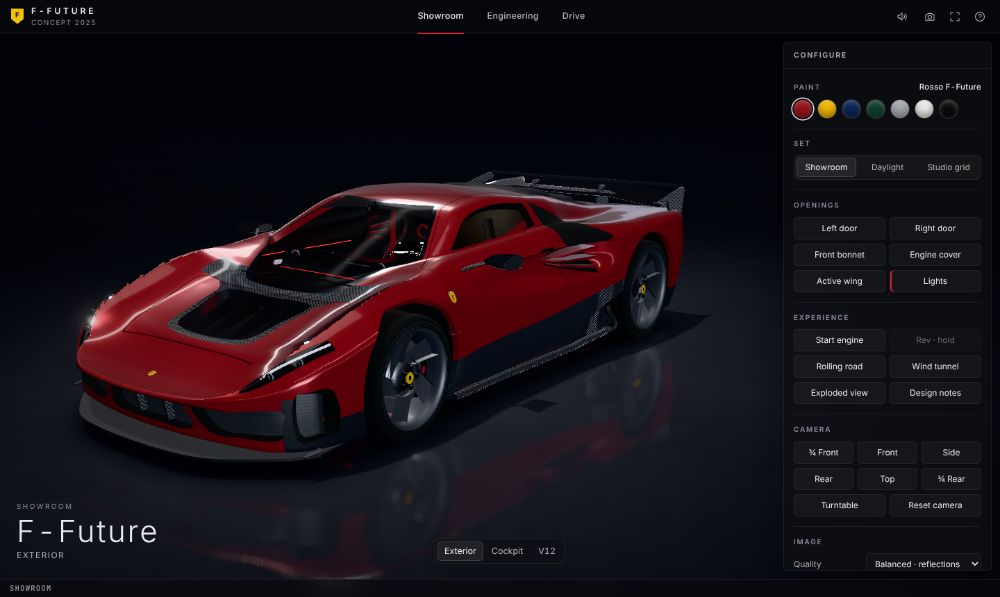
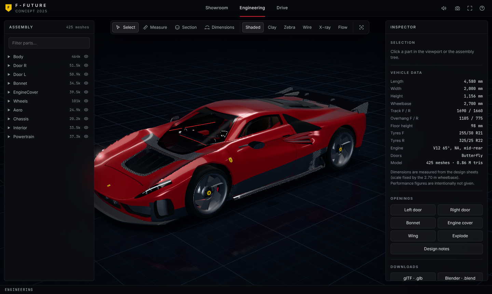
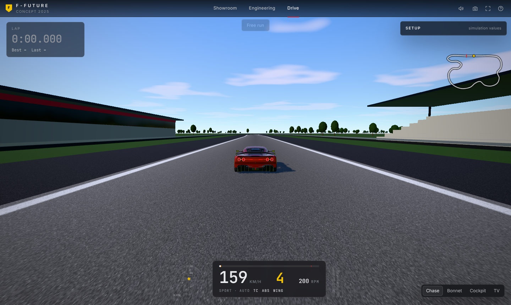
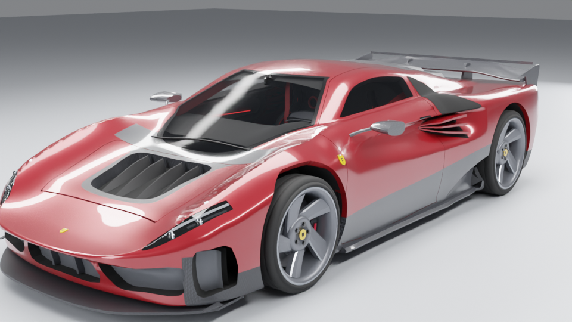
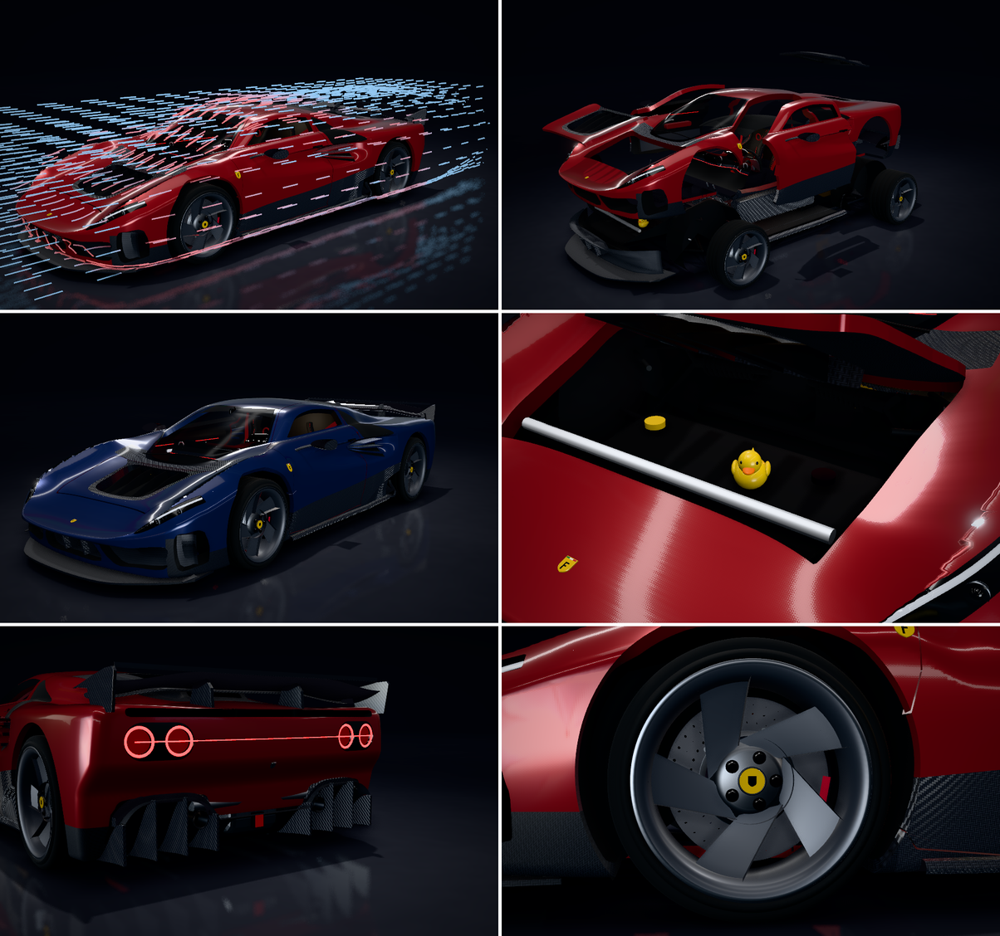

# Ferrari F-Future: interactive concept, engineering workspace and drive simulator

A procedurally engineered, real-time 3D model of the **F-Future (2025)** concept, built from the seven
reference sheets in [`reference/`](reference/) (orthographic views, blueprint, technical spec, surface detail,
complete design and annotated hero renders). Everything is real geometry generated in code with Three.js:
body panels, glass, lights, aero, wheels, brakes, suspension, cockpit and the naturally aspirated V12.

The web app has three workspaces:

* **Showroom**: a photographic studio. The car sits on a polished epoxy floor that reflects it, in a dark
  showroom lit by a real HDR photograph of a photo studio plus long strip softboxes. It has working
  butterfly doors, bonnet, engine cover and active wing, plus paint, sets, scenes (Exterior, Cockpit, V12)
  and a physically modelled V12 sound.
* **Engineering**: an assembly tree with per-part triangle counts, a part inspector, distance measurement,
  a section plane, CAD-style overall dimensions and surface analysis (clay, zebra, wireframe, X-ray, flow
  incidence).
* **Drive**: the car on an original, fictional 3.4 km test circuit. It has a real-time vehicle simulation,
  four cameras, HUD with lap timing and live delta, minimap, g-meter, telemetry traces with CSV export,
  an editable setup sheet and four challenges.



| Engineering | Drive |
|---|---|
|  |  |

## Run it

No build step is needed. Serve the folder with any static web server and open `index.html`:

```bash
npx http-server . -p 8080 -c-1      # or: python3 -m http.server 8080
# then open http://localhost:8080
```

It also works as-is on GitHub Pages. Three.js r187, the fonts (Inter and JetBrains Mono, SIL OFL) and the
HDR environments are bundled, so no CDN is needed. Sound needs a secure origin (https or localhost) for
the AudioWorklet. Elsewhere it falls back to a simpler oscillator engine.

## Showroom

| Action | Mouse / touch | Keyboard |
|---|---|---|
| Orbit / zoom / pan | drag · wheel or pinch · right-drag or two fingers | — |
| Scenes | *Exterior · Cockpit · V12* | `1` `2` `3` |
| Open / close | click the door, bonnet, engine cover or wing, or the Openings buttons | `L` `R` `H` `E` `W` |
| Camera presets | *¾ Front* is the exact camera of your hero render | `Q F S B U` |
| Engine | *Start engine*, then hold *Rev* | `I`, hold `Space` |
| Turntable, X-ray, design notes | Camera / Experience sections | `T` `X` `N` |
| Sound on/off, photo, shortcuts | top bar | `M` `P` `?` |

**Sets**: *Showroom* (dark, reflective floor), *Daylight* (white cove) and *Studio grid*. **Image**: quality
(*High* adds ambient occlusion; *Balanced* keeps the floor reflections; *Low* is for phones) and look
(*Neutral* for true colours, *Filmic* for AgX tone mapping).

### How the image is made

* Image-based lighting from a CC0 HDR photograph (Poly Haven, via `@pmndrs/assets`), combined with
  emissive strip lights and prefiltered into a 512 px PMREM environment.
* The floor uses a planar reflection with a rough, Fresnel-weighted blur and a baked soft contact
  shadow. A key light adds soft shadows.
* The paint is a clear-coated metallic. Flakes are hashed in object space, so they sparkle up close
  without UVs, and a faint orange-peel ripple on the clear coat bends straight reflections like real
  sprayed lacquer. Both fade out below pixel size.
* Post-processing: GTAO (High), bloom only above an HDR threshold (LEDs and glints), Khronos PBR
  Neutral or AgX tone mapping, a lens vignette and fine film grain.

### Engine sound

The V12 is not a recording. It is synthesised live in an AudioWorklet from a crank-angle model
(`src/viewer/audio/engine-worklet.js`):

* **Firing pulses**: a 65° V12 fires each bank every 120°, the second bank 65° later, so the firing
  intervals alternate 65° and 55°. Each event sends a blow-down pressure pulse into its bank's exhaust.
  The pulse width is a constant crank angle and there is a small cylinder-to-cylinder variation.
* **Exhaust**: per-bank waveguides (header, collector, silencer) with reflection and loss give the
  resonances and the bank-to-bank beat.
* **Other sources**: intake roar, cam-drive whine, starter motor, a 9,000 rpm rev limiter that cuts
  two sparks in three, and overrun pops on lift-off.
* **Perspective**: an exterior view with a short room reverb, and a cabin view that is low-passed with
  structure-borne boom.

`qa/engine_sound_demo.mp3` is an offline render of the model (start, idle, limiter, overrun, cabin,
shut-down). `node tools/dev/engine-audio.mjs` re-renders it and prints level and spectrum checks.

## Engineering workspace

| Tool | What it does | Key |
|---|---|---|
| Select | Click a part, or pick it in the assembly tree (filterable, with triangle counts and show/hide). The inspector shows instances, triangles, vertices, extents, centre and material parameters. | `V` |
| Frame / Isolate / Hide | Fly to the selection, show only the selection, or hide it. *Shift+H* shows all. | `F` `I` `H` |
| Measure | Click two surface points to get the distance and Δx/Δy/Δz in millimetres. | `G` |
| Section | A clipping plane along X, Y or Z with an offset slider and a flip button. Measuring respects the cut. | `C` |
| Dimensions | CAD-style overall length, width, height, wheelbase and tracks, from `src/car/dims.js`. | `D` |
| Shading | *Shaded, Clay, Zebra* (reflection-line continuity), *Wire* (tessellation), *X-ray*, *Flow* (see below). | — |

*Flow* colours each surface by its geometric incidence to the oncoming air (Newtonian sin²). It is
**indicative only: it is not a CFD result and not a pressure measurement**. The *Vehicle data* table
lists only dimensions measured from the sheets. **No power, torque, mass or performance figures are
claimed for the F-Future.**

## Drive workspace

Press *Start* on the intro card, or `5` from anywhere.

| | Keyboard | Gamepad | Touch |
|---|---|---|---|
| Throttle / brake | `W` `S` or `↑` `↓` | RT / LT | GAS / BRAKE |
| Steer | `A` `D` or `←` `→` | left stick | ◀ ▶ |
| Gears | automatic, or `Q` `E` (manual), `X` toggles | LB / RB | — |
| Camera | `C`: chase, bonnet, cockpit, TV | Y | buttons |
| Reset, telemetry, manettino, pause | `R` `T` `G` `Esc` | X, —, —, Start | — |

* **Vehicle model** (`src/drive/vehicle.js`): a planar model integrated at 240 Hz. It has:
  * longitudinal load transfer and a Pacejka-style tyre with load sensitivity and a friction circle;
  * aerodynamic drag and downforce, where the active wing rises under braking and in fast corners and
    flattens on straights;
  * a seven-speed gearbox, rear-wheel drive and launch clutch slip;
  * cornering-aware ABS, traction control and a stability assist. The manettino (*WET, SPORT, RACE,
    CT OFF*) sets how much the assists intervene and the grip level.
* **Challenges**: *Free run*, *Hot lap* (flying start, best lap and live delta saved in your browser),
  *0–100 km/h*, and *Demo lap* (an autopilot drives so you can watch the telemetry).
* **Telemetry**: `T` shows the last 30 s of speed, rpm, throttle, brake and steering. *CSV* exports the
  whole session (time, distance, speed, rpm, gear, pedals, steering, g-forces, position).
* **Setup sheet**: engine output, mass, weight distribution, grip, downforce, drag, aero balance,
  brake bias and final drive.

> All driving parameters and results are **simulation values chosen for believable behaviour, not
> official or claimed F-Future specifications**. Only the geometry (wheelbase, tracks, tyre sizes)
> comes from the design sheets.

## Experience mode and secrets

The Showroom's *Experience* section also has a rolling road, a wind tunnel (streamlines that bend around
the real body surface), an exploded view and paint swatches. Leave the studio alone for 45 seconds and it
slowly turns the car.

There are **six secrets**. The Configure panel counts how many you have found and gives a hint for each.

<details><summary>Spoilers</summary>

1. The Konami code (↑ ↑ ↓ ↓ ← → ← → B A) unlocks a hidden gold paint, *Oro Segreto*.
2. Click the shield on the nose five times: horn, headlight flash and a motto.
3. Open the front bonnet and click the rubber duck in the frunk.
4. Type `v12` for an instant red-line burst.
5. In the cockpit, click the red manettino dial on the steering wheel to cycle WET, SPORT, RACE and CT OFF.
6. Click the red button on the steering wheel to start or stop the engine.
</details>

## Deliverables

| File | What it is |
|---|---|
| `index.html` + `src/` | The web app: viewer and showroom (`src/viewer`), car generator (`src/car`), drive simulator (`src/drive`). |
| `models/ferrari-f-future.glb` | Optimised glTF 2.0 binary (19 MB): about 425 named mesh nodes, about 860k triangles, PBR materials (clearcoat, anisotropy, sheen, emissive), embedded textures, `KHR_mesh_quantization`. It includes 5 animations: `Door_L_Open`, `Door_R_Open`, `Bonnet_Open`, `EngineCover_Open`, `Wing_Active`. It passes the Khronos glTF validator with no errors. |
| `models/ferrari-f-future.blend` | An editable Blender project (Blender 5.x). It has a collection per sub-assembly, the animations as Actions, a studio (floor, area-light softboxes, world), a hero camera matching the reference and Cycles settings.  |
| `qa/` | QA comparisons against the reference views ([QA report](qa/QA-REPORT.md)). |



Textures (carbon twill with anisotropy direction maps, metallic flake, leather grain, honeycomb mesh,
cross-drilled discs, tyre sidewall lettering, display graphics) are generated procedurally. The GLB embeds them,
so there are no loose texture files to manage.

### Scene hierarchy

```
F-Future
├─ Body                 shell (paint / carbon / gloss-black zones), glass, lights, intakes, badges
├─ Door_L, Door_R       butterfly pivots → skin, window, hem & inner shell, door card, mirror
├─ Bonnet               pivot → lid, Fluxus vent + duct fins, carbon underside
├─ EngineCover          pivot → carbon cover, louvre slats, V12 window
├─ Wheels               Wheel_FL/FR/RL/RR → rotating rim + tyre, disc, bell, caliper, upright
├─ Aero                 splitter, dive planes, intake blades + honeycomb, diffuser + fins,
│                       side skirts, Testarossa strakes, scoop grilles, RearWing (+ RearWing_Active)
├─ Chassis              arch liners, venturi floor, frunk, engine bay, radiators, suspension
├─ Interior             tub, dashboard, displays, steering wheel, seats, belts, console, pedals, headliner
└─ Powertrain           V12_Engine (block, banks, cam covers, coils, intake, headers), transaxle, exhaust
```

## How the model is built

* **Dimensions** come from the orthographic reference sheet, with the scale fixed by a 2.70 m wheelbase
  (`src/car/dims.js`). Length 4.58 m, width 2.00 m, height 1.156 m. Tyres are 255/30 R21 front and 325/25 R22 rear.
* **Body shell** (`src/car/bodyShape.js`): an implicit (signed-field) surface made from the measured
  side, plan and section profiles. Side wall, fender/hood/haunch top surface, floor, canopy and nose/tail
  faces are blended with controlled fillets. `bodyMesher.js` samples it as about 520 cross-section rings, with
  analytic normals for clean reflections.
* **Panels** (`src/car/body.js`): the continuous shell is cut along exact 2D trim curves (side, top, front and
  rear projections) into doors, bonnet, engine cover, glass, light housings, vents and intakes, with real
  4 mm panel gaps. Every cut edge gets a *hem* (return flange) that forms door jambs, panel thickness, vent
  walls and intake ducts.
* **Butterfly doors** hinge on an axis along the A-pillar. `tools/dev/hinge-check.mjs` sweeps the door
  through 0–83° against the body surface. It finds **no interference** at the 66° opening angle used.
* The V12 is a 65° vee with 12 cylinders, individual runners and velocity stacks, and 6-into-1 headers per bank.
  No power or displacement figures are implied anywhere.

## Regenerating the exports

```bash
node tools/export-glb.mjs build/raw.glb          # builds the car in headless Chromium and exports it
npx @gltf-transform/cli dedup build/raw.glb build/d.glb
npx @gltf-transform/cli quantize build/d.glb models/ferrari-f-future.glb
blender -b -P tools/blender/make_blend.py -- models/ferrari-f-future.glb models/ferrari-f-future.blend
./tools/qa-gallery.sh                             # re-renders all QA comparisons into qa/
```

`tools/shoot.mjs` renders any view or mode headlessly, for example
`node tools/shoot.mjs out mode:engine "quality=high"`.

## Notes

* The badges are a generic yellow heraldic shield with a tricolore and a stylised "F". They are not
  reproductions of trademarked logo artwork. The plaque signature from the sheet is not reproduced.
* Some details the references don't show are filled with coherent design choices, and the QA report lists them.
  These include twin exhaust outlets inside the rear light band, the cockpit layout and colours, the
  under-floor strakes, the suspension and the frunk.
