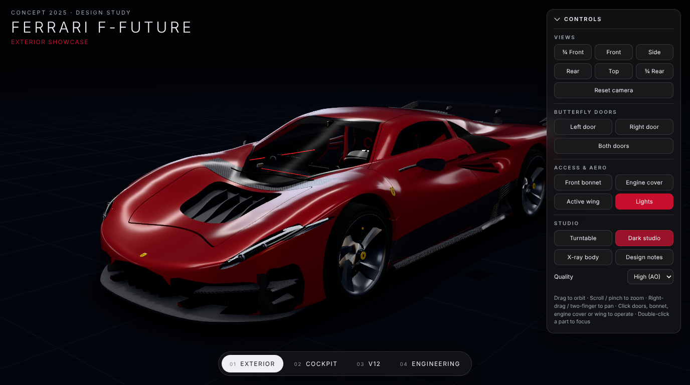
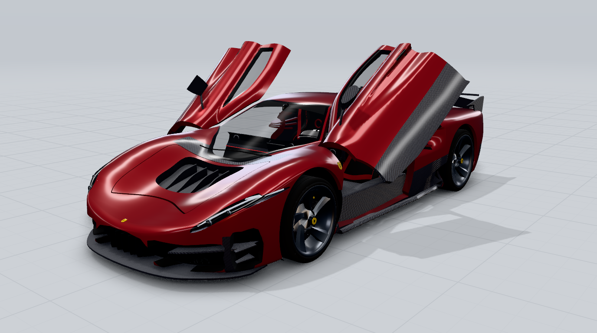
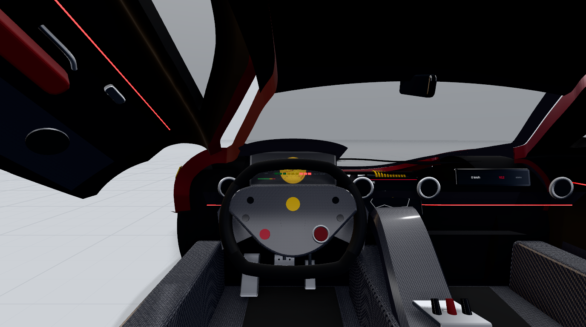
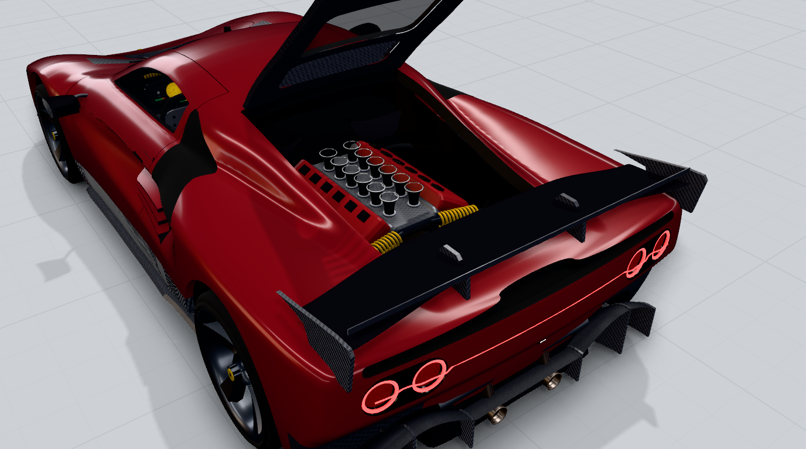
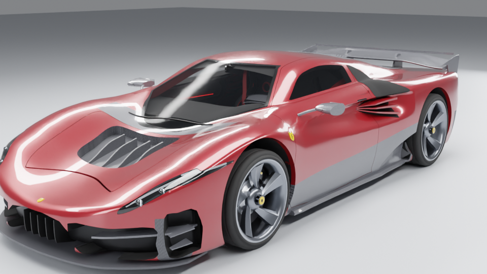

# Ferrari F-Future — interactive 3D concept model

A procedurally engineered, real-time 3D model of the **F-Future (2025)** concept, built from the seven
reference sheets in [`reference/`](reference/) (orthographic views, blueprint, technical spec, surface detail,
complete design and annotated hero renders). Everything — body panels, glass, lights, aero, wheels,
brakes, suspension, cockpit and the naturally aspirated V12 — is real geometry generated in code with
Three.js. It runs in a browser studio with working butterfly doors, opening bonnet and engine cover, an
active rear wing, four viewing modes and annotated design notes.



| Butterfly doors | Cockpit | V12 inspection |
|---|---|---|
|  |  |  |

## Run it

No build step is needed. Serve the folder with any static web server and open `index.html`:

```bash
npx http-server . -p 8080 -c-1      # or: python3 -m http.server 8080
# then open http://localhost:8080
```

It also works as-is on GitHub Pages. Three.js r187 is bundled in `vendor/three/`, so no CDN is needed.
On a desktop the car is generated in about 3 seconds.

## Using the viewer

| Action | Mouse / touch | Keyboard |
|---|---|---|
| Orbit / zoom / pan | drag · wheel or pinch · right-drag or two fingers | — |
| Focus a component | double-click it | — |
| Open / close a door | click the door, or *Left / Right / Both doors* | `L`, `R` |
| Front bonnet, engine cover | click it, or the panel buttons | `H`, `E` |
| Active wing (raise + incidence) | click the wing, or *Active wing* | `W` |
| Camera presets | *¾ Front* (the exact camera of your hero render), *Front, Side, Rear, Top, ¾ Rear*, *Reset camera* | `Q F S B U` |
| Viewing modes | bottom bar | `1`–`4` |
| Turntable, X-ray, design notes | Studio section | `T`, `X`, `N` |

**Viewing modes**

1. **Exterior showcase**: all panels closed, hero camera.
2. **Interior cockpit showcase**: the left door opens and the camera moves to the driver's eye. Drag to look around.
3. **Engine inspection**: the engine cover opens and the camera frames the V12.
4. **Detailed engineering view**: the body turns to X-ray, every panel opens, and the design notes from
   your sheet appear as clickable hotspots (*Ducti Fluxus attivi integrati*, *Ala attiva leggendaria tipo F40*,
   *Scultura aerodinamica ispirata al Testarossa*, *Effetto suolo Fontana*, …).

Studio options: light or dark studio, quality presets (*High* adds GTAO ambient occlusion; *Balanced* and *Low*
are for tablets and phones), lights on/off. On narrow screens the layout switches to a mobile one with a
collapsible control sheet and adjusts the camera framing for portrait.

## Deliverables

| File | What it is |
|---|---|
| `index.html` + `src/` | The interactive web viewer (Three.js). |
| `models/ferrari-f-future.glb` | Optimised glTF 2.0 binary (17 MB): 397 named mesh nodes, about 800k triangles, PBR materials (clearcoat, anisotropy, sheen, emissive), embedded textures, `KHR_mesh_quantization`. It includes 5 animations: `Door_L_Open`, `Door_R_Open`, `Bonnet_Open`, `EngineCover_Open`, `Wing_Active`. It passes the Khronos glTF validator with no errors. |
| `models/ferrari-f-future.blend` | An editable Blender project (Blender 5.x). It has a collection per sub-assembly, the animations as Actions, a studio (floor, area-light softboxes, world), a hero camera matching the reference and Cycles settings.  |
| `qa/` | QA comparisons against the reference views ([QA report](qa/QA-REPORT.md)). |

Textures (carbon twill with anisotropy direction maps, metallic flake, leather grain, honeycomb mesh,
cross-drilled discs, tyre sidewall lettering, display graphics) are generated procedurally. The GLB embeds them,
so there are no loose texture files to manage.

### Scene hierarchy

```
F-Future
├─ Body                 shell (paint / carbon / gloss-black zones), glass, lights, intakes, badges
├─ Door_L, Door_R       butterfly pivots → skin, window, hem & inner shell, door card, mirror
├─ Bonnet               pivot → lid, Fluxus vent + duct fins, carbon underside
├─ EngineCover          pivot → carbon cover, louvre slats, V12 window
├─ Wheels               Wheel_FL/FR/RL/RR → rotating rim + tyre, disc, bell, caliper, upright
├─ Aero                 splitter, dive planes, intake blades + honeycomb, diffuser + fins,
│                       side skirts, Testarossa strakes, scoop grilles, RearWing (+ RearWing_Active)
├─ Chassis              arch liners, venturi floor, frunk, engine bay, radiators, suspension
├─ Interior             tub, dashboard, displays, steering wheel, seats, belts, console, pedals, headliner
└─ Powertrain           V12_Engine (block, banks, cam covers, coils, intake, headers), transaxle, exhaust
```

## How the model is built

* **Dimensions** come from the orthographic reference sheet, with the scale fixed by a 2.70 m wheelbase
  (`src/car/dims.js`). Length 4.58 m, width 2.00 m, height 1.156 m. Tyres are 255/30 R21 front and 325/25 R22 rear.
* **Body shell** (`src/car/bodyShape.js`): an implicit (signed-field) surface made from the measured
  side, plan and section profiles. Side wall, fender/hood/haunch top surface, floor, canopy and nose/tail
  faces are blended with controlled fillets. `bodyMesher.js` samples it as about 520 cross-section rings, with
  analytic normals for clean reflections.
* **Panels** (`src/car/body.js`): the continuous shell is cut along exact 2D trim curves (side, top, front and
  rear projections) into doors, bonnet, engine cover, glass, light housings, vents and intakes, with real
  4 mm panel gaps. Every cut edge gets a *hem* (return flange) that forms door jambs, panel thickness, vent
  walls and intake ducts.
* **Butterfly doors** hinge on an axis along the A-pillar. `tools/dev/hinge-check.mjs` sweeps the door
  through 0–83° against the body surface. It finds **no interference** at the 66° opening angle used.
* The V12 is a 65° vee with 12 cylinders, individual runners and velocity stacks, and 6-into-1 headers per bank.
  No power or displacement figures are implied anywhere.

## Regenerating the exports

```bash
node tools/export-glb.mjs build/raw.glb          # builds the car in headless Chromium and exports it
npx @gltf-transform/cli dedup build/raw.glb build/d.glb
npx @gltf-transform/cli quantize build/d.glb models/ferrari-f-future.glb
blender -b -P tools/blender/make_blend.py -- models/ferrari-f-future.glb models/ferrari-f-future.blend
./tools/qa-gallery.sh                             # re-renders all QA comparisons into qa/
```

`tools/shoot.mjs` renders any view or mode headlessly, for example
`node tools/shoot.mjs out mode:engine "quality=high"`.

## Notes

* The badges are a generic yellow heraldic shield with a tricolore and a stylised "F". They are not
  reproductions of trademarked logo artwork. The plaque signature from the sheet is not reproduced.
* Some details the references don't show are filled with coherent design choices, and the QA report lists them.
  These include twin exhaust outlets inside the rear light band, the cockpit layout and colours, the
  under-floor strakes, the suspension and the frunk.
