# F-Future 3D model: QA against the reference sheets

The views below were rendered headlessly (`tools/qa-gallery.sh`) and compared against
`reference/ref-01-orthographic-views.png` and `reference/ref-02-design-annotations.jpg`.
Each comparison stacks three panels top to bottom: the **reference**, **this model**, and the model with
**the reference silhouette traced on top in magenta**.

> This model does not match the reference renders 100%. The references are AI-generated concept renders and are not
> fully consistent between views. For example, the top view puts the windscreen base about 0.3 m further forward than
> the side view does. Where the views disagree, the **side view** sets the length and height dimensions and the
> **top view** sets the plan dimensions.

## Measured fidelity

`node tools/dev/fidelity.mjs` compares the generated body against points measured on the reference sheet
(1 px = 7.92 mm in the side view):

| Check | Result |
|---|---|
| Side silhouette (roofline, windscreen, hood/fender line, deck), 63 points | mean error **4.7 mm**, 90 % within **8.5 mm** |
| Plan outline (half-widths), 30 points | mean error **11 mm**, 90 % within **23 mm** |
| Hero render camera (recovered from 10 landmarks by `tools/fit_camera.py`) | **26 px RMS** on the 2576 px reference, so the hero comparison below is pixel-aligned |
| Overall | 4.58 m long × 2.00 m wide × 1.156 m high, wheelbase 2.70 m |
| Largest deviations | nose tip (the reference outline there includes the splitter's beak, modelled as a separate part) and a 2 cm softer windscreen header |

## Newer reference sheets (ref-03 … ref-07)

The blueprint, technical-spec, surface-detail, complete-design and annotated-hero sheets were calibrated
separately (`tools/refs/`). Side views are scaled by the wheel hubs (2.70 m wheelbase), and the plan, front and rear views by the overall length or height.
The complete-design sheet (ref-06) is a clean studio render, so it gives the most reliable outlines. Its side view measures
4.57 m long and 1.12 m high, which agrees with the first sheet (4.58 m, 1.156 m), so the overall proportions were kept.

| View (sheet 06) | Comparison (reference, model; then each with the other's outline traced) | Silhouette overlap (IoU), before → after this pass |
|---|---|---|
| Side | 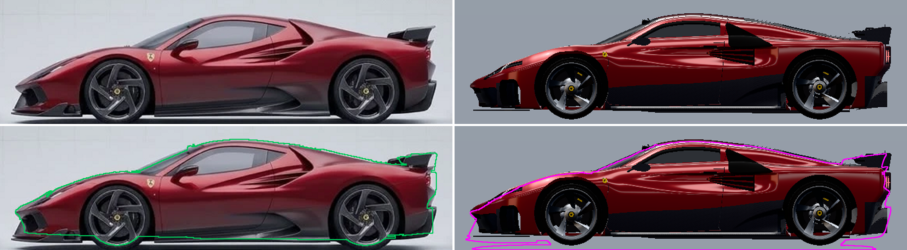 | 0.844 → **0.855** |
| Top | 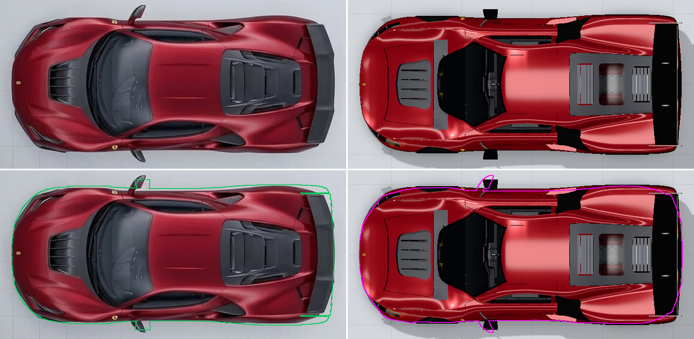 | 0.956 → **0.959** |
| Front | 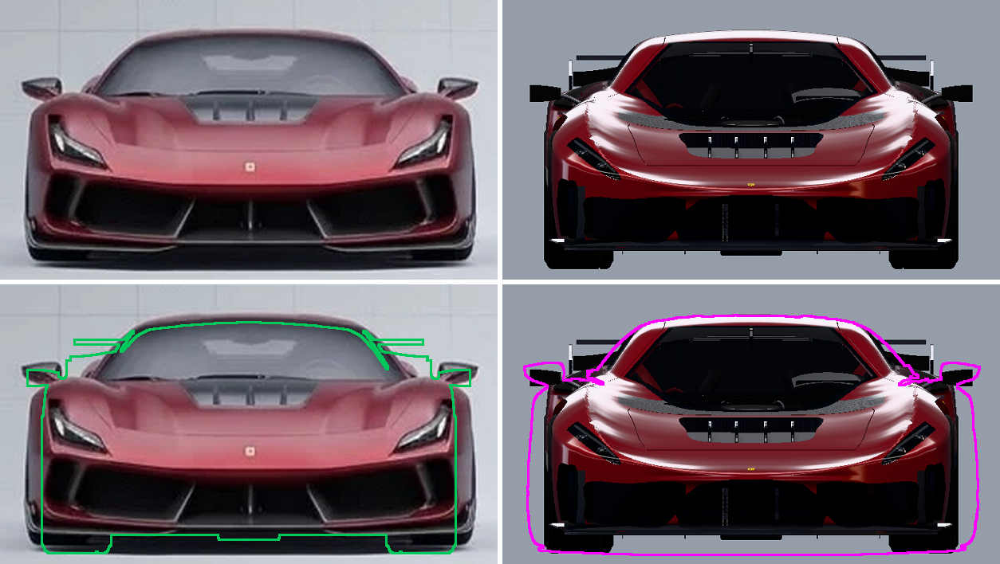 | 0.840 → **0.847** |
| Rear | 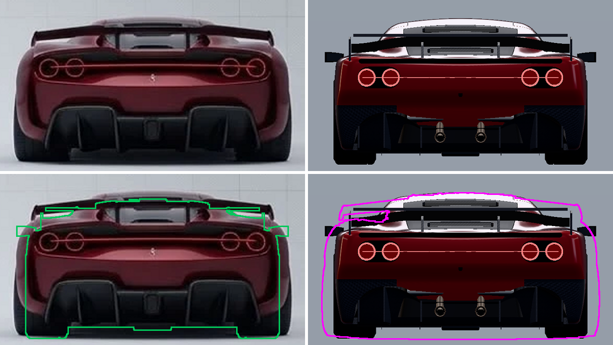 | 0.812 → **0.827** |

Remodelled in this pass to match the new sheets:
- **Side:** a concave sweep from the front of the door into the Testarossa scoop, which has three body-coloured
  blades over a dark recess that narrows to a point. A **flying-buttress void** sits behind the door window
  (replacing the old quarter window). The black box ahead of the rear wheel is gone.
- **Front:** **steep, slim sabre headlights** with a tail that runs back along the fender. A **single wide intake with a
  flat top**, split by angled body-coloured fangs, plus narrow **corner ducts**.
- **Rear:** **two black "goggles"** each holding a pair of ring lights, with the LED line running over the paint between them.
  A **dark full-width vent** under the ducktail. A **gull-wing** with pylons framing the rear window. An **arched twin-tunnel diffuser** with bold
  fins. Round exhausts sit low in the diffuser centre instead of in the light band.
- **Wheels:** **straight, twisted (propeller) spokes**, as in the wheel & brake detail panel.
- **Engine cover:** satin carbon with a smoked window, so it reads dark as on the top and rear views.

Remaining differences: the reference fascia and fender crests are more sharply faceted. The bonnet-vent fins and scoop
blades are finer. The underbody plan shows more channels than the venturi floor here. The sheets themselves differ by
a few centimetres in places (for example, the windscreen header height).

## Front-end sharpening pass

The front bumper and fenders were sharpened against the front views and the colour-coded surface view (ref-05):
- **Fender crests:** the bonnet now has a flat, low centre with steep walls climbing to a **sharp ridge**, the fender top
  breaks away outboard of the crest, and the shoulder into the side wall is tighter.
- **Bumper:** the bonnet's leading edge is the most forward line, the bumper face leans back to a **crisp raised lip**
  over the intake, then tucks under into a **carbon lower lip** and the splitter.
- **Intakes:** honeycomb set close behind the openings, two bold carbon blades in the centre, clean corner ducts, a
  single canard per corner, and dark bonnet-vent fins.
- **Clean-ups:** the wheel-arch cut and arch liners no longer break through the lower bonnet surface.

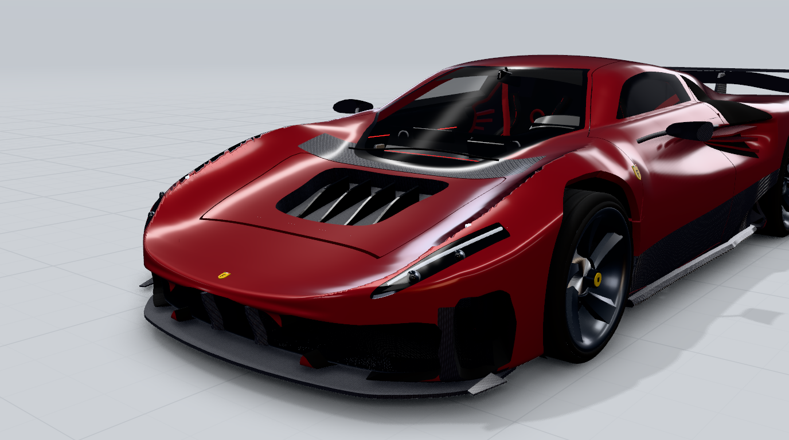

Measured after this pass: plan outline mean error **7.5 mm** (was 11.2 mm), side silhouette 5.4 mm, and sheet-06
silhouette overlap side 0.854, top 0.960, front 0.847, rear 0.828.

## View-by-view

| View | Comparison | Assessment |
|---|---|---|
| Side | 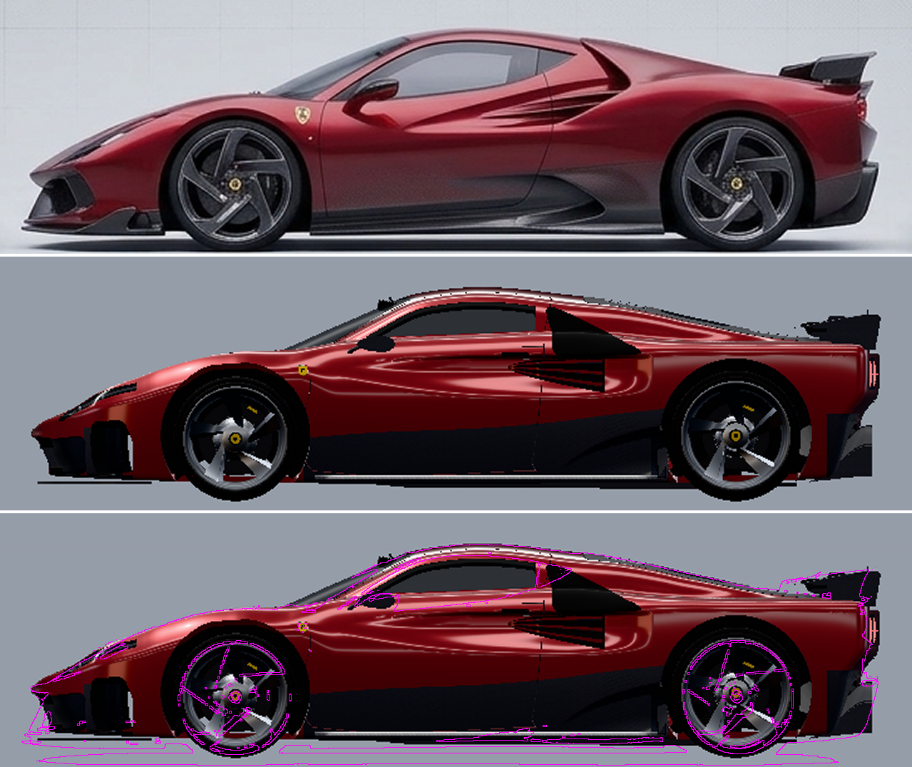 | Roofline, fender line, wheel positions and sizes, door shut lines, mirror, side window, the concave sweep from the mirror into the Testarossa scoop, the grey carbon lower body and the tucked tail with dark diffuser corners all match. **Deviation:** the reference's scoop blades are finer, with crisper edges. |
| Front | 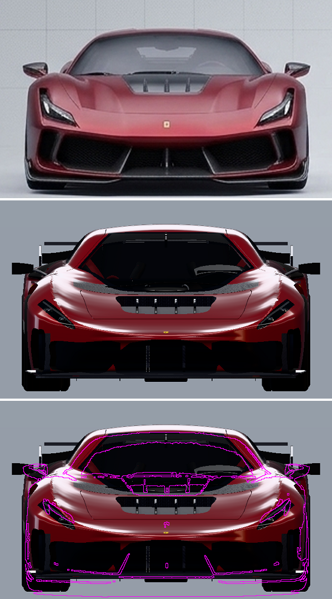 | Width, fender positions, bonnet vent, the angled sabre headlights, the centre intake with slats, the side intakes with carbon vanes, the body-coloured fangs, the splitter and the badge position match. **Deviation:** the reference's fascia surfaces are more faceted. |
| Rear | 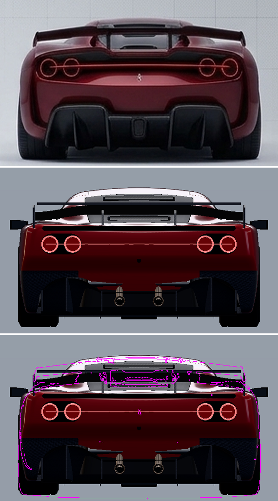 | The quad ring tail-lights, full-width LED bar, black band, centre emblem, diffuser tunnels with fins and centre lamp, and the wing span with end plates and pylons match closely. **Added detail:** twin exhaust outlets in the band centre (the reference shows no tailpipes). |
| Top | 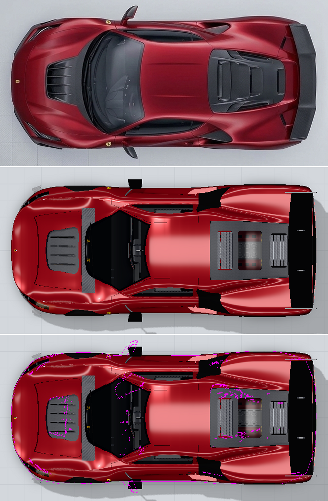 | Plan outline, bonnet vent, windscreen and roof, side windows, louvred engine cover, rear wing and mirrors are in place. The engine cover adds a glass section so the V12 is visible (interpretation). |
| Three-quarter (reference hero angle) | 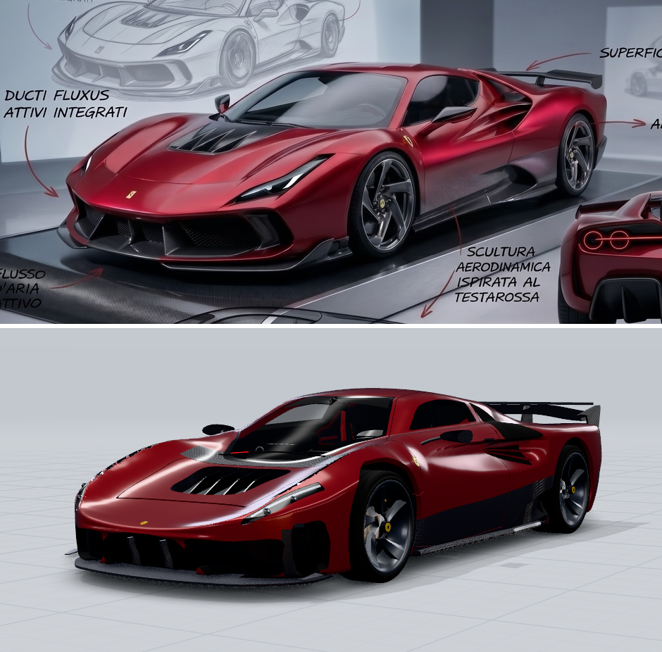 | Rendered from the **exact camera recovered from your hero render**, so the two images line up. Silhouette, wheel positions, wing, mirrors and nose are in the same place. Since the first version, these were remodelled to match: the front fascia (centre intake plus two large side intakes divided by body-coloured fangs), the black sabre headlights with LED brows, the scoop (body-coloured blades over a dark recess), the grey carbon lower body, the dark tail and diffuser corners, and the carbon cowl in front of the windscreen. **Remaining differences:** the reference's fender crests are sharper-edged, and its bonnet vent fins are more pronounced. |

## Requirement checklist (section 9 of the brief)

| Item | Status | How it was verified |
|---|---|---|
| Front / rear / side / top / ¾ accuracy | ✔ with the deviations listed above | Comparisons above and the `fidelity.mjs` numbers |
| Wheel placement and proportions | ✔ | Wheel centres and diameters overlay the reference circles in `compare_side.png` (front ⌀0.672 m, rear ⌀0.704 m) |
| Door opening mechanics | ✔ | `tools/dev/hinge-check.mjs` samples door points through 0.2–1.45 rad: **0 intersections** with the body. The viewer uses 66°. See `render_butterfly_doors.png` |
| Interior completeness | ✔ | Seats on rails with belts, dashboard, cluster, centre and passenger displays, wheel with paddles, console and gear gate, pedals, door cards, headliner, ambient LEDs (`render_cockpit.png`) |
| Engine visibility and detailing | ✔ | V12 visible through the engine-cover window and with the cover open (`render_v12.png`) |
| Material quality | ✔ | Clear-coat metallic paint, anisotropic carbon, tinted glass, rubber, aluminium, chrome, leather/Alcantara, emissive LEDs |
| Interactive controls | ✔ | `tools/dev/smoke-ui.mjs` clicks every control and mode at both quality levels: **no console errors** |
| GLB validity | ✔ | Khronos glTF validator (via glTF-Transform): **0 errors** |
| Blender project | ✔ | `.blend` regenerated from the GLB and rendered in Cycles (`render_blender_cycles_preview.png`) |

## Design interpretations (details the references don't show)

* Cockpit layout and trim: black leather, Alcantara and carbon with red accents; yellow-faced rev counter.
* Twin exhaust outlets placed inside the rear light band, between the wing pylons.
* Frunk, underbody venturi strakes, side radiators behind the scoops, suspension geometry.
* A glass section in the engine cover so the V12 can be seen.
* Badges: a generic yellow shield with a tricolore and a stylised "F" (no trademarked artwork).

## Other renders

| | |
|---|---|
| 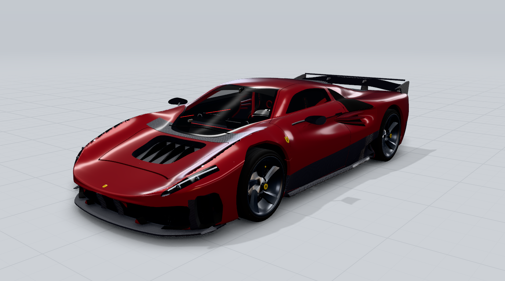 | 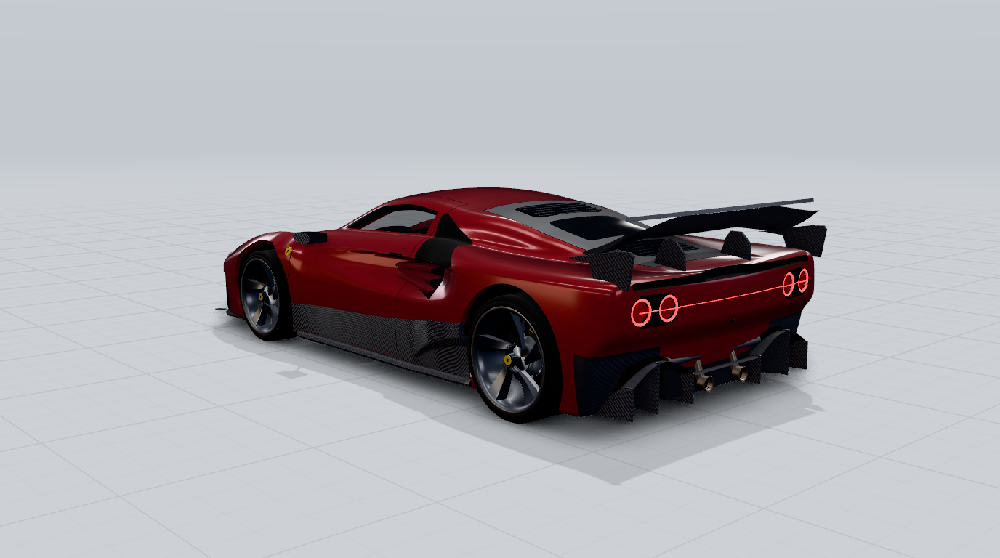 |
| 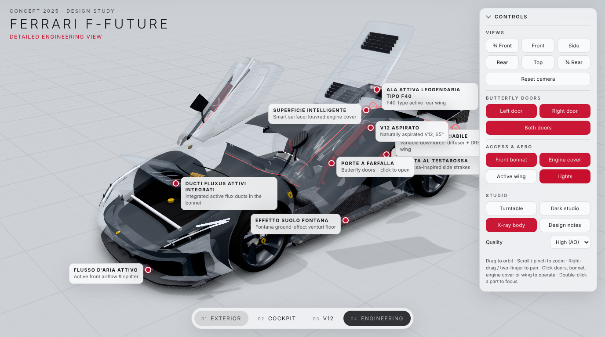 | 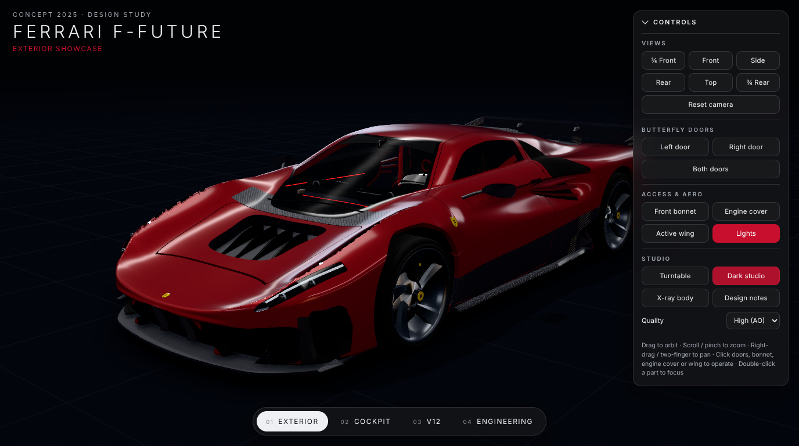 |
